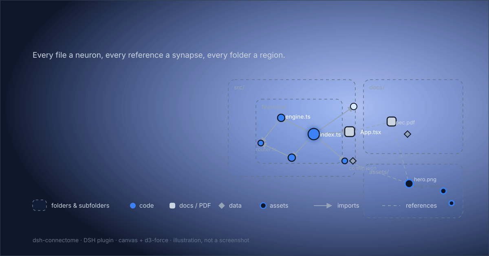

# Connectome

[](https://www.npmjs.com/package/dsh-connectome)
[](https://github.com/elalamiimed/dsh-connectome/actions/workflows/ci.yml)
[](LICENSE)
[](https://github.com/deepseek-ai/deepseek-harness)

**A living map of your workspace for the DeepSeek Harness Web UI** — every file is a
neuron, every reference is a synapse, every folder is a region. Connectome scans the
current workspace — code, documents, PDFs, images, data, media, fonts and unclassified
binaries alike — draws the file/folder graph on a single `<canvas>` with `d3-force`
physics, lets you trace any relationship, and turns a click on a neuron into that file
in the harness' own right-sidebar preview.



<sub>The banner is an illustration of the canvas graph, not a screenshot.</sub>

## Features

- **One canvas, hundreds of nodes, 60 fps.** Nodes and links are painted into a single
  `<canvas>`; there is no DOM node per file. `d3-force` runs the layout, the plugin's
  own `requestAnimationFrame` loop ticks it, and the simulation stops when idle.
- **Every file type.** Code, styles, Markdown, PDFs, Word/PowerPoint/Excel documents,
  images, fonts, data files, media and unclassified binaries all become neurons. Each
  is tagged with a coarse family — **code** (circles), **docs** (rounded squares),
  **data** (diamonds), **assets** such as images/media/fonts/archives (rings) and
  **other** (small dots). The legend counts the families and the node tooltip reports
  the kind, extension and byte size.
- **Folders and subfolders.** Directory regions are painted behind the graph as nested
  outlines computed from the live layout, labelled with the folder name; the header's
  folder toggle hides or shows them. Folders are a map of where files live, not force
  nodes, so they never displace the relationship layout.
- **Relationships you can read.** Dependency edges carry an arrowhead at the referenced
  file: **solid** for `import` / `export … from` / dynamic `import()` / `require` / CSS
  `@import`, **dashed** for HTML attributes, Markdown links/images and CSS `url(...)`
  assets. Hover a link to see both endpoints and the relation kind.
- **Neighbourhood inspection.** Hovering a node highlights its neighbourhood and lists
  its direct ties (`→` imports, `←` imported by), each clickable, with a `+N` summary
  for the rest. Great for seeing how two modules — or two "engine" files — meet.
- **Click to open.** Clicking a neuron opens that file in the harness' right-Sidebar
  document preview (`ctx.sidebarRight.openResource` with a
  `dsh-resource://file/session/…` address): code with line numbers, Markdown, PDFs,
  images and Office documents, all inside DSH. A missing preview or selected session is
  explained in the footer.
- **Theme-aware.** The canvas reads its colors from the live `--dsw-alias-*` theme
  tokens at runtime, so light/dark switches recolor the graph.
- **Workspace switcher, rescan, fit, zoom, pan, node drag, `Esc` to close.**
- **Local by design.** No telemetry, no network calls, no workspace data leaves your
  machine.

## Install

Connectome is a DSH **bundle** plugin: installing it adds a Host row (workspace scanner
+ HTTP route) and a lazy browser module (the canvas UI).

### Requirements

- DeepSeek Harness **0.2.1-rc.2 or newer** (Desktop or a `dsh web` deployment with the
  standard Web bundle).
- Node.js 18+ only if you build from source; the release ships `client.js` prebuilt.

### From the Web UI (recommended)

Open the sidebar's **Plugins** page, choose **Install**, and enter one of:

```text
dsh-connectome                                   # npm (recommended)
github:elalamiimed/dsh-connectome                # straight from GitHub
```

The npm package is live at **[npmjs.com/package/dsh-connectome](https://www.npmjs.com/package/dsh-connectome)**;
the plugin manager enables the bundle after a successful install. Open the sidebar
panel list's **More** menu and pick **🧠 Connectome**.

### From a terminal

The DSH CLI forwards package operations to the profile; then enable the bundle in
**Plugins** (or keep using the Web UI above, which does both steps):

```bash
dsh plugin --profile desktop add dsh-connectome
# or straight from GitHub:
dsh plugin --profile desktop add github:elalamiimed/dsh-connectome
```

> **Troubleshooting — `dsh-connectome declares no dsh.bundle`.** While a brand-new
> npm package is being reviewed, npm can hold it at a `0.0.0-stage` placeholder that
> declares no bundle. A mirror (for example `registry.npmmirror.com`) may keep serving
> that placeholder for a while after the real release lands, and the plugin manager's
> pre-install check then refuses the package with this message. Choose **Official npm
> registry** in the install dialog's registry selector, retry after the mirror syncs,
> or install the `github:` spec instead. To see what a registry currently has:
>
> ```bash
> npm view dsh-connectome dist-tags --registry https://registry.npmmirror.com
> ```

### Manual / development install

```bash
git clone https://github.com/elalamiimed/dsh-connectome.git
cd dsh-connectome
# then install the folder as a bundle in the running profile, e.g. with
# plugin_manager install_bundle <absolute-path>, or `dsh plugin add link:<absolute-path>`
```

> Note: the npm name `dsh-project-brain` belongs to an unrelated DSH plugin. This
> project is published as **`dsh-connectome`**; the GitHub repository still uses the
> "project brain" working title in its history only.

## Usage

1. Open the sidebar panel list's **More** menu → **🧠 Connectome**.
2. The dialog scans the current workspace and fits the graph to view. The legend in the
   top-left corner counts each file family present.
3. Use the header to switch workspace (when several are registered), toggle the folder
   outlines, rescan, fit or zoom; drag the background to pan; scroll to zoom around the
   pointer; drag a node to pull it.
4. Hover a node or a link for the relationship tooltip. Hovering a node also emphasizes
   its folder chain. Click a neuron to open the file in the right sidebar. `Esc` / the ✕
   button closes the dialog.

## Supported dependency syntax

The Host extracts links with small, dependency-free regexes (bare package names are
deliberately **not** expanded into `node_modules`):

| Files | Relationships |
| --- | --- |
| JS / TS / JSX / TSX / Vue / Svelte | `import … from`, `export … from`, dynamic `import()`, `require()` (any target, including assets) |
| CSS / SCSS / Sass / Less / Stylus | `@import`, `@use`, `@forward`, `url(...)` assets (images, fonts) |
| HTML | `<script src>`, `<link href>`, ``/`<source>`/`<iframe>`/`<video>`/`<audio>`/`<track>` `src`, `<a href>`, `<object data>`, `<video poster>` |
| Markdown | relative links and images — code, PDFs, images, any file |
| Python | `import x`, `from . import y` |

Every non-ignored regular file becomes a node, so a referenced PDF, image, font or data
file appears on the graph even though only text formats are parsed for further links.
Only relative, root-relative and `@/` / `~/` specifiers resolve to workspace files.
`node_modules`, `.git`, build outputs, caches and dot-directories are skipped;
lockfiles, source maps, minified bundles and OS junk (`.DS_Store`, `Thumbs.db`, editor
swaps) are excluded as well.

## How it works

### Host half (`index.js`)

- `POST /connectome/api/graph` — same-origin route fenced through
  `ctx.connection.requestRejection(req)`; optional JSON body `{ "root": "<workspace>" }`.
- Resolves the workspace root from the registered workspaces (or the current working
  directory) and scans it under hard caps: 2,000 file nodes, 12,000 directory entries,
  1,500 parsed files, 512 KiB read per file, an 8 s soft time budget.
- Every non-ignored regular file becomes a node with a coarse `kind`; text formats are
  parsed for references and a reference links any scanned file it resolves to. The
  folder index is returned alongside the nodes so the Client can draw directory regions.
- Returns the graph:

```json
{
  "ok": true,
  "root": "C:\\path\\workspace",
  "roots": [{ "path": "C:\\path\\workspace", "title": "my-project" }],
  "nodes": [
    { "id": "src/index.js", "label": "index.js", "ext": ".js", "size": 1234, "dir": "src", "kind": "code" },
    { "id": "src/util.js", "label": "util.js", "ext": ".js", "size": 456, "dir": "src", "kind": "code" },
    { "id": "docs/readme.md", "label": "readme.md", "ext": ".md", "size": 789, "dir": "docs", "kind": "doc" },
    { "id": "docs/spec.pdf", "label": "spec.pdf", "ext": ".pdf", "size": 48213, "dir": "docs", "kind": "doc" }
  ],
  "links": [
    { "source": "docs/readme.md", "target": "docs/spec.pdf", "kind": "markdown-link" },
    { "source": "src/index.js", "target": "src/util.js", "kind": "import" }
  ],
  "folders": [
    { "id": "docs", "parent": null, "depth": 1, "files": 2, "total": 2 },
    { "id": "src", "parent": null, "depth": 1, "files": 2, "total": 2 }
  ],
  "stats": {
    "files": 4,
    "folders": 2,
    "scanned": 3,
    "links": 2,
    "truncated": false,
    "durationMs": 4,
    "kinds": { "code": 2, "doc": 2, "data": 0, "image": 0, "media": 0, "archive": 0, "font": 0, "other": 0 }
  }
}
```

### Client half (`client.source.js` → `client.js`)

- Registers `sidebar.panellist.actions` (the menu row) and `shell.overlay` (the dialog),
  both through `ctx.slots.inject` / `ctx.slots.register`.
- Builds the d3 simulation once per loaded graph with `simulation.stop()`, then ticks it
  from the plugin's `requestAnimationFrame` loop; hover changes update React state, but
  pointer moves only mutate transforms, and frames are requested only while needed.
- Batches all solid edges into one stroke, all structural edges into a dashed stroke,
  all arrowheads into one fill, node shapes into one fill per family, and folder
  outlines into one fill + stroke pass. Link hit-testing is a screen-space
  segment-distance pass — no DOM.
- Folder/subfolder outlines are recomputed from the live node positions each frame
  (linear in nodes × depth), so regions follow the simulation instead of freezing the
  layout; their labels appear once the zoom level makes them legible, and the hovered
  node's whole folder chain is emphasized. The header toggle only requests a repaint.
- Layout seeds d3's phyllotaxis spiral and uses weak `forceX`/`forceY` centering, so
  disconnected files stay in one cloud and fit-to-view never zooms to sub-pixel dots.
- `ResizeObserver` keeps the backing store matched to CSS size (DPR clamped to 2);
  `MutationObserver` re-reads theme tokens when the app theme changes.
- `d3-force` (plus its UMD dependencies) is inlined into `client.js` by `build.mjs`:
  the browser module table has no runtime npm resolution, so the bundle is
  self-contained. `vendor/` pins the exact ISC-licensed distributions.
- Clicking a node builds the harness' own file address
  (`dsh-resource://file/session/<session>/<path>`) and calls
  `ctx.get('sidebarRight').openResource(...)`; the on-screen session comes from
  `sidebarRight.mounted`, with the UI Session adapter as fallback.

## Privacy

Connectome reads the workspace through the Host process, exactly like the rest of DSH.
It sends **nothing** to the network: no analytics, no remote API calls, no file
contents uploaded. The graph response stays between the Host and your local page; open
files are displayed by DSH's built-in preview, and Connectome itself never keeps or
transmits file contents.

## Performance

- Canvas painting: one path per file family, one stroke per edge family, and one
  folder-outline pass; only the hovered neighbourhood gets labels.
- The simulation stops at `alphaMin`; an interaction kicks it again.
- Measured layout cost on a development machine: ~1.1 ms/tick at 300 nodes, ~8 ms/tick
  at 2,000 nodes; a 2,000-node / ~3,300-link scan runs in about half a second warm.
  Folder outlines add one linear pass over the laid-out nodes per painted frame.
- Large workspaces are capped and report `stats.truncated`; the dialog shows a
  "partial scan" marker.

## Development

No dev dependencies are needed — `vendor/` is committed and the tests use Node builtins.

```bash
node build.mjs      # regenerate client.js from client.source.js + vendor/
npm test           # scanner + artifact + package/release contract tests
npm run check      # node --check on index.js and the generated client
npm pack --dry-run # inspect exactly what npm would publish
```

`npm install` is only needed to rebuild `client.js` from a different d3-force copy:
`node build.mjs --modules <node_modules dir>` looks there after `vendor/`.
See [`CONTRIBUTING.md`](CONTRIBUTING.md) for the project layout and review rules, and
[`PUBLISHING.md`](PUBLISHING.md) for the maintainer release flow.

## Styling note

The project-wide design-token rule asks frontend artifacts to use the `--ds-*` scale.
This plugin is a Harness UI surface, so it deliberately splits the two systems:

- **Colors** come only from the host's live `--dsw-alias-*` theme tokens (this is what
  keeps the graph legible in both light and dark mode).
- **Spacing / radii / shadows / font sizes** use a locally declared `--ds-*` token
  layer (4px rhythm, 4/8/12/16/20/24 px spacing, 4/8/12/16 px radii, the shadow scale
  and the caption/body-sm/body/h3 type scale) — no off-scale numeric styling.

## Limitations

- Regex-based parsing: aliases beyond `@/`/`~/`, `tsconfig` path maps and bundler
  resolution rules are not modeled; bare package names do not become nodes.
- Binary formats (PDF, images, Office, media) are nodes and preview through DSH's
  document preview where it supports them; unknown suffixes show the preview's
  unsupported message. Binaries are never parsed, so they do not contribute links.
- Directory regions are an outline overlay computed from the layout, not force nodes:
  folders do not repel or pull files, and empty folders do not appear.
- Large repositories hit the scanner caps (see above) and show a partial graph; the
  walk is alphabetical, so one deeply crowded folder can consume the node budget.
- The graph is a viewer, not an editor: there is no refactoring, search or saved layout.

## License

[MIT](LICENSE) © 2026 elalamiimed.

Bundled d3 distributions (`vendor/`) are ISC licensed, Copyright 2010–2021 Mike
Bostock; see [`vendor/LICENSE-d3.txt`](vendor/LICENSE-d3.txt). DeepSeek Harness and its
packages are separate projects with their own licenses.
